# SS-MAE: Spatial-Spectral Masked Autoencoders for Forest Encroachment Detection

Self-supervised pretraining of a Vision Transformer on 13-band Sentinel-2 imagery (EuroSAT), reused for
land-cover classification and for detecting **forest / nature encroachment** (Forest → Farmland, Urban, Industry)
as a siamese change-detection task.

The project began as a test of one idea: that masking **whole spectral bands** in addition to spatial
patches ("dual spatial-spectral masking") produces better features for multispectral remote sensing.
After a correctness audit and three controlled ablations, **the evidence points the other way**, and the
repository documents that result in full: what was claimed, what broke, what the ablations showed, and the
configuration that actually works.

> **Short version**
> 1. **Spectral masking hurts.** Turning it off raises the EuroSAT linear probe from **52.5% → 75.4%** and frozen
>    change-detection F1 from **0.827 → 0.907**. The effect is monotonic across four settings and has a clear mechanism.
> 2. **The fusion operator matters more than the encoder.** The original head used `|f1 − f2|`, which cannot tell
>    Forest→Urban from Urban→Forest. The signed difference `f1 − f2` is worth up to **+0.117 F1**.
> 3. **With both fixed, pretraining finally helps.** Frozen F1 is **0.907 vs 0.874** for a random-init encoder. Under
>    the original recipe, pretraining lost to random initialisation at all ten checkpoints.

The full write-up, with tables and figures, is in [reports/SSMAE_ablation_report.pdf](reports/SSMAE_ablation_report.pdf).

---

## Contents

- [Repository layout](#repository-layout)
- [Data](#data)
- [Method](#method)
- [Results](#results)
  - [1. Pretraining](#1-pretraining)
  - [2. EuroSAT land-cover classification](#2-eurosat-land-cover-classification)
  - [3. Encroachment (change) detection](#3-encroachment-change-detection)
  - [4. Label efficiency](#4-label-efficiency)
  - [5. Transfer to real bitemporal data (LEVIR-CD, OSCD)](#5-transfer-to-real-bitemporal-data-levir-cd-oscd)
  - [6. Adaptive (learned) band masking](#6-adaptive-learned-band-masking)
- [Correctness audit](#correctness-audit)
- [Ablations](#ablations)
  - [A. Spectral masking ratio](#a-spectral-masking-ratio)
  - [B. Pretraining duration](#b-pretraining-duration)
  - [C. Fusion operator](#c-fusion-operator)
- [Synthesis: recommended configuration](#synthesis-recommended-configuration)
- [What the evidence supports (paper direction)](#what-the-evidence-supports-paper-direction)
- [Threats to validity](#threats-to-validity)
- [Next experiments](#next-experiments)
- [Reproducing](#reproducing)

---

## Repository layout

```
.
├── notebooks/
│   └── ssmae_pipeline.ipynb      # full pipeline: data → pretrain → classify → change detection → transfer
├── ablations/
│   ├── ablation_spectral.py      # Ablation A: spectral masking ratio sweep
│   ├── ablation_pretrain_epochs.py  # Ablation B: pretraining duration sweep
│   ├── ablation_fusion.py        # Ablation C: siamese fusion operator sweep
│   ├── plot_*.py                 # figure scripts for A, B, C
│   ├── build_report.py           # builds reports/SSMAE_ablation_report.pdf from the results
│   ├── results/                  # raw JSON results for every ablation run
│   ├── figures/                  # ablation figures
│   └── logs/                     # stdout of the ablation runs
├── figures/                      # figures produced by the notebook
├── results/                      # CSV / TXT outputs produced by the notebook
├── reports/
│   └── SSMAE_ablation_report.pdf # 8-page audit + ablation report
└── ruff.toml                     # lint config (notebook cells re-import on purpose)
```

These are **not** in the repo because of their size (≈17 GB). They are listed in `.gitignore`:
datasets (`eurosat-dataset/`, `levir-cd-change-detection/`, `oscd-dataset/`), model weights
(`checkpoints/`, `ablations/ckpt/`), and the dataset zips.

---

## Data

| Dataset | Use | Details | Source (Kaggle) |
|---|---|---|---|
| **EuroSAT (all bands)** | Pretraining, classification, synthetic change pairs | Sentinel-2, 13 bands, 64×64 px, 10 classes. Split 18,900 / 5,400 / 2,700 | `apollo2506/eurosat-dataset` |
| **LEVIR-CD** | Transfer to real bitemporal building change | RGB, 1024×1024, 445 / 64 / 128 image pairs (train/val/test), cut into balanced patches (2,170 train / 810 test) | `mdrifaturrahman33/levir-cd-change-detection` |
| **OSCD** | Zero-shot encroachment analysis on real cities | Sentinel-2 multispectral, 24 cities, 2,139 patches of 64×64 | `mohamedazizbellaaj/oscd-dataset` |

EuroSAT classes: AnnualCrop, Forest, HerbaceousVegetation, Highway, Industrial, Pasture, PermanentCrop,
Residential, River, SeaLake.

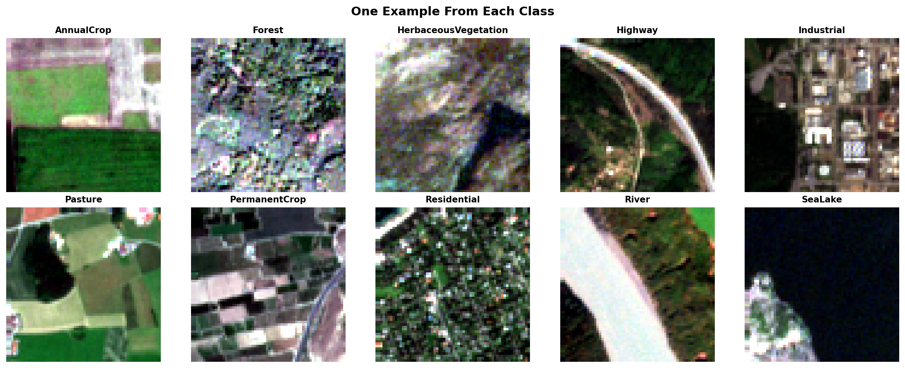

> The Kaggle folder is labelled "LEVIR-CD+", but its split sizes (445/64/128) match the **original LEVIR-CD**,
> not LEVIR-CD+ (637/348). Results here are not comparable to published LEVIR-CD+ numbers.

---

## Method

**Encoder.** A ViT with 8×8 patches (64 tokens per 64×64 tile), 512-dim embeddings, 8 layers, 8 heads, and
**29.2 M parameters**. A lightweight decoder (256-dim, 4 layers) reconstructs the masked content.

**Dual masking (as originally proposed).**
- *Spatial*: hide 75% of the 8×8 patches, chosen independently for each band.
- *Spectral*: remove 30% of the bands outright.
- Together this hides **80.8%** of the input.

**Downstream tasks.**
- **Classification**: the pretrained encoder with a linear head, fine-tuned on EuroSAT labels. The ablations use a
  linear probe on frozen features.
- **Encroachment / change detection**: a siamese network. Both tiles go through the shared encoder, the two
  embeddings `f1, f2` are fused, and a small head (0.15 M params) predicts *exploitation vs. no change*.
  Training pairs are built from EuroSAT classes. Positive pairs are exploitation transitions:

  | Transition | Cause |
  |---|---|
  | Forest → AnnualCrop | farming |
  | Forest → Residential | urban expansion |
  | Forest → Industrial | industry |
  | HerbaceousVegetation → AnnualCrop | grassland conversion |
  | Pasture → Industrial | pasture loss |

**Training setup.** AdamW with a cosine schedule, seed 42, on an NVIDIA RTX 4500 Ada.
- Pretraining: batch 128, lr 1.5e-4, 100 epochs.
- Change detection: 2,000 train / 600 val balanced pairs, 20 epochs, head lr 3e-4, encoder lr 1e-5 when unfrozen.

---

## Results

All numbers below come from the **post-audit** code (see [Correctness audit](#correctness-audit)).

### 1. Pretraining

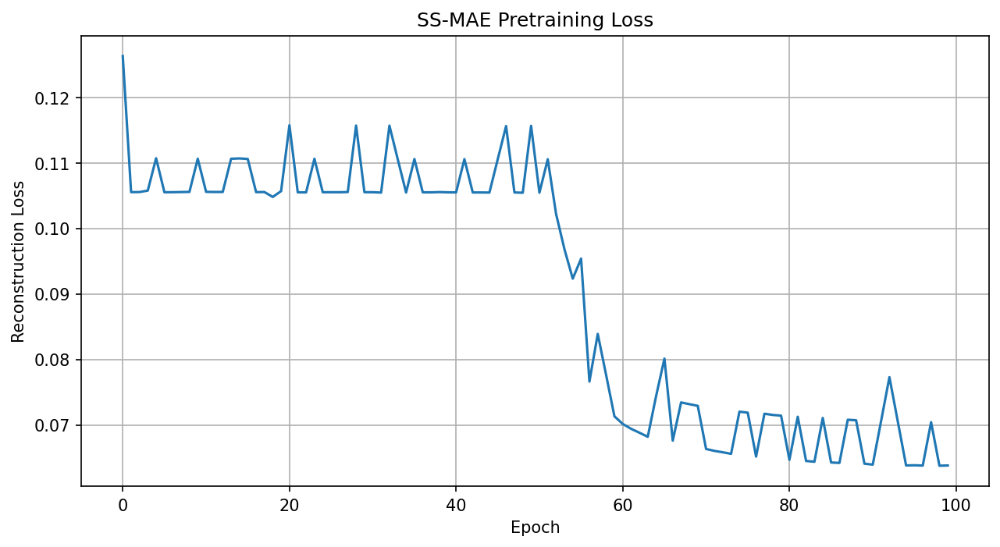

The reconstruction loss sits on a plateau at ≈0.105 for about 50 epochs, then drops to **0.0638** at epoch 100.
Ablation A explains the plateau: a band that has been removed entirely cannot be reconstructed from spatial
context, so the model settles at predicting the band mean. It escapes only late, if at all.

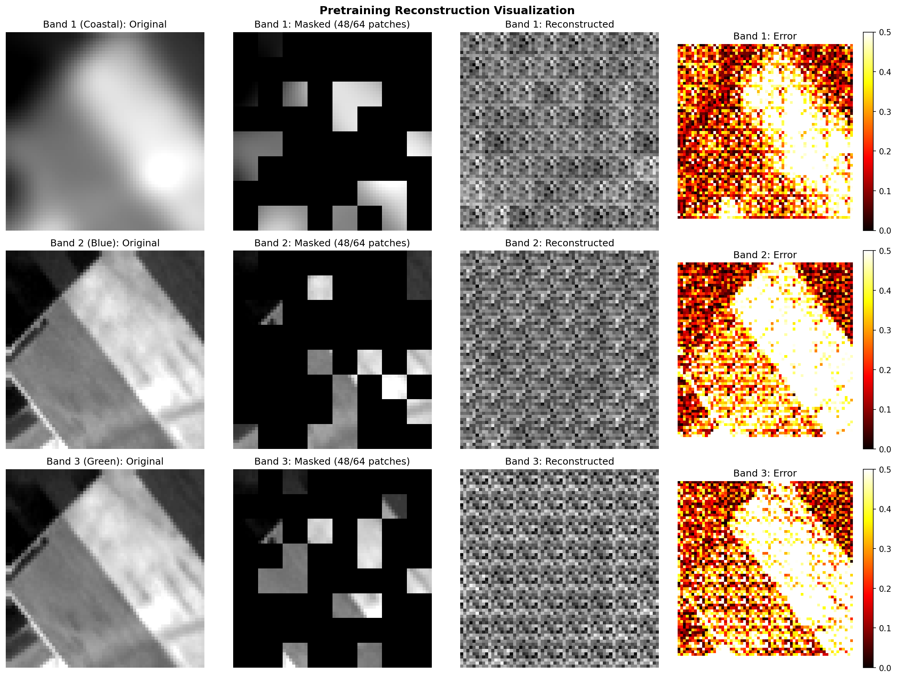

### 2. EuroSAT land-cover classification

The pretrained encoder, fine-tuned on 100% of labels, reaches the following on the 2,700-image test set:

| Metric | Value |
|---|---|
| **Test accuracy** | **95.52%** |
| **Macro F1** | **0.9536** |

| Class | Precision | Recall | F1 |
|---|---|---|---|
| AnnualCrop | 0.98 | 0.93 | 0.95 |
| Forest | 0.98 | 1.00 | 0.99 |
| HerbaceousVegetation | 0.91 | 0.95 | 0.93 |
| Highway | 0.96 | 0.88 | 0.92 |
| Industrial | 0.96 | 0.98 | 0.97 |
| Pasture | 0.95 | 0.94 | 0.94 |
| PermanentCrop | 0.90 | 0.90 | 0.90 |
| Residential | 0.97 | 0.98 | 0.98 |
| River | 0.95 | 0.98 | 0.96 |
| SeaLake | 0.99 | 0.99 | 0.99 |

Forest is classified almost perfectly (recall 1.00). The remaining errors are mostly between spectrally
similar agricultural classes (PermanentCrop, AnnualCrop, HerbaceousVegetation) and Highway.

| 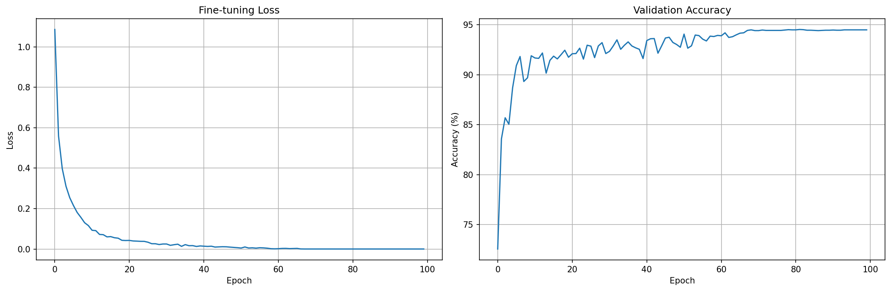 | 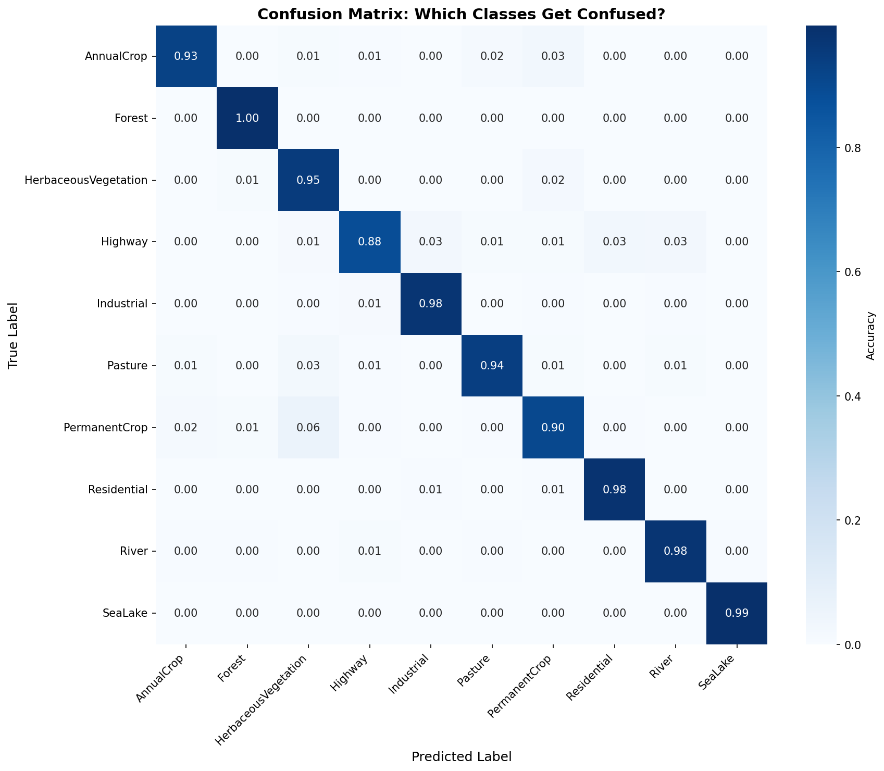 |
|---|---|

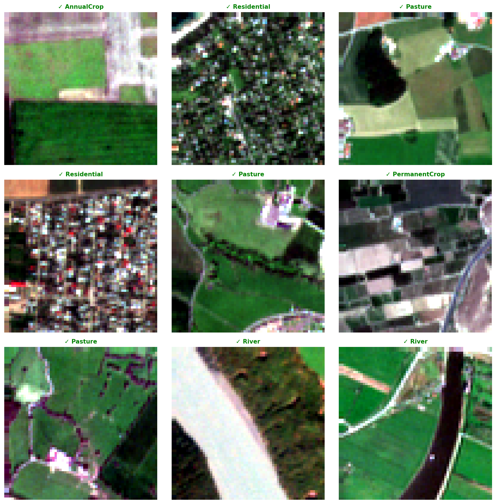

**With 10% of labels (1,890 images):**

| Setting | Test acc. | Macro F1 |
|---|---|---|
| SS-MAE pretrained (original recipe), 50 epochs | 82.30% | 0.8182 |
| Pretrained vs **from scratch**, matched run | 71.22% vs 71.07% | 0.6960 vs 0.6994 |

Under a matched comparison, pretraining with the original recipe gives **no measurable gain** at 10% labels.
An earlier "99.3% performance retention" figure was an artefact: that run reused an encoder already
fine-tuned on 100% of labels. See the [audit](#correctness-audit).

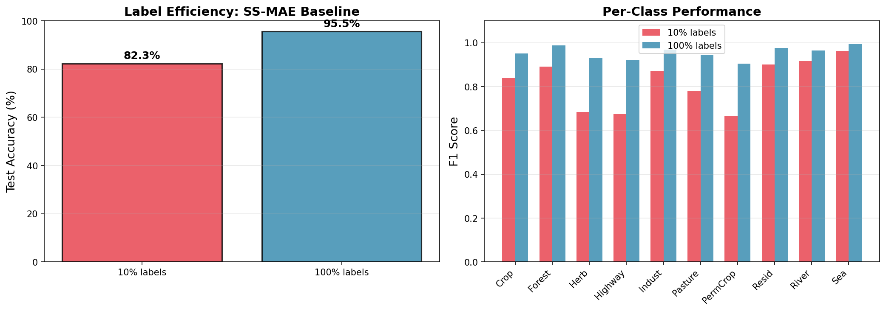

### 3. Encroachment (change) detection

**Matched budget** (every method: same 2,000 pairs, 20 epochs, `|f1 − f2|` fusion):

| Method | Best val F1 |
|---|---|
| Random-init encoder + head | **0.8859** |
| SS-MAE fine-tuned | 0.8781 |
| Simple CNN (0.43 M params, no pretraining) | 0.8677 |
| SS-MAE frozen | 0.7074 |

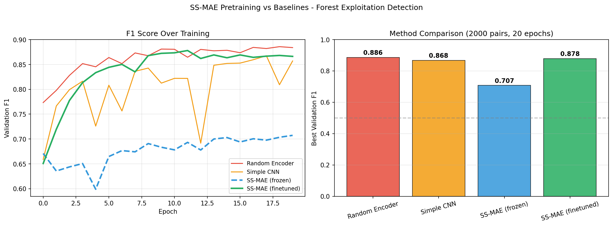

Under the original recipe, **self-supervised pretraining did not beat a randomly initialised encoder.**
This result motivated the ablations.

**Per-cause detection rate** (frozen SS-MAE, 2,000 pairs, F1 0.7074, AUC 0.7394):

| Transition | Detected |
|---|---|
| Forest → Industrial | 80% |
| Pasture → Industrial | 78% |
| Forest → Residential | 70% |
| Forest → AnnualCrop | 68% |
| HerbVeg → AnnualCrop | 59% |

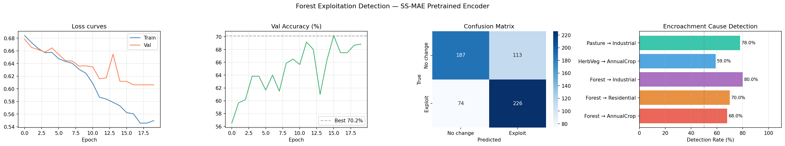

**Larger-budget run** (5,000 pairs, 30 epochs): F1 **0.9416**, AUC 0.9796. Per-cause detection rates were
93–99% (Forest→Industrial 99%, Pasture→Industrial 99%, Forest→Residential 95%, Forest→AnnualCrop 93%,
HerbVeg→AnnualCrop 86%). Source: [results/final_paper_results.txt](results/final_paper_results.txt).

> ⚠️ **Do not cite 0.9416 (or the earlier 0.9505) as "SS-MAE beats the baselines".** This run used 2.5× the data
> and 1.5× the epochs of the baselines it was compared with. At a matched budget, the random encoder wins
> (table above). The [label-efficiency sweep](#4-label-efficiency) is the controlled version of this comparison.

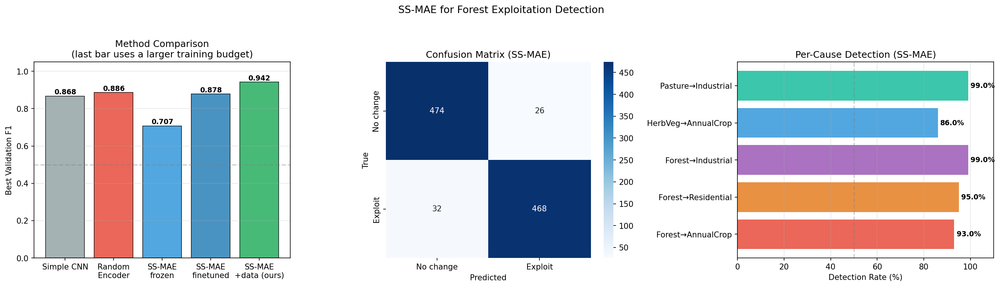

### 4. Label efficiency

The siamese change detector was trained on 1–100% of 5,000 pairs, comparing a pretrained encoder (original
recipe) with a random-init encoder:

| Labels | Pairs | SS-MAE | Random | Gap |
|---|---|---|---|---|
| 1% | 50 | 0.5289 | 0.6276 | −0.0987 |
| 5% | 250 | 0.6401 | 0.7769 | **−0.1369** |
| 10% | 500 | 0.8111 | 0.8012 | +0.0099 |
| 25% | 1,250 | 0.8540 | 0.8639 | −0.0100 |
| 50% | 2,500 | 0.9060 | 0.9049 | +0.0011 |
| 100% | 5,000 | 0.9223 | 0.9305 | −0.0082 |

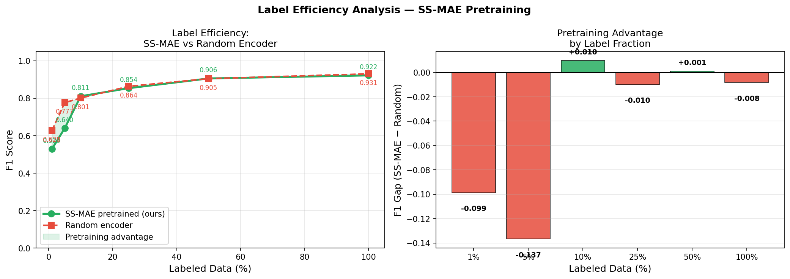

Pretraining loses at 4 of 6 fractions. It loses **worst at 1% and 5%**, which is the opposite of what
self-supervision is supposed to deliver. The two wins are within single-seed noise.

### 5. Transfer to real bitemporal data (LEVIR-CD, OSCD)

**LEVIR-CD (RGB, building change)**

| Setting | F1 | Notes |
|---|---|---|
| Zero-shot (EuroSAT model, no retraining) | 0.000 | Accuracy 50%, AUC 0.575: predicts "no change" for everything |
| SS-MAE + RGB adapter, fine-tuned | **0.7657** | 3-band → 13-band input adapter in front of the encoder |

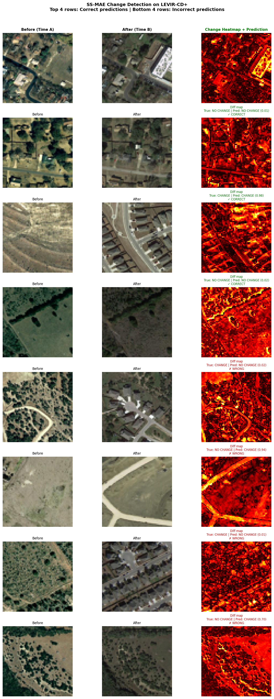

The domain gap is large: the sensor changes (Sentinel-2 at 10 m to aerial RGB at 0.5 m), the band count
changes, and the type of change differs. The adapter recovers usable performance, but zero-shot transfer
fails completely.

**OSCD (Sentinel-2, 24 cities, zero-shot)**

- Feature-space analysis over 200 patches
  ([results/final_results.csv](results/final_results.csv)): changed patches have a clearly larger
  T1→T2 embedding distance than unchanged ones (mean **22.3 vs 12.8**). The encoder's features do respond to
  real temporal change.
- The rule-based Forest→Urban encroachment classifier flagged **0 patches out of 2,139** in all 24 cities, at
  every confidence threshold tried (0.5–0.8)
  ([results/oscd_encroachment_report.csv](results/oscd_encroachment_report.csv)). OSCD is almost entirely urban
  scenes, and its ground-truth masks mark *change*, not land-cover class. A zero count is therefore expected, and
  these predictions are unvalidated.

### 6. Adaptive (learned) band masking

A variant learns a per-band "importance" through Gumbel-Softmax, so that the masking probability adapts per
band. It reached a lower reconstruction loss (0.0387 vs 0.0638, 39% lower), and the band importances separated
clearly (variance 0.158):

| Highest "importance" (masked ~11%) | Lowest "importance" (masked ~45–49%) |
|---|---|
| B01 Coastal, B10 Water vapour, B04 Red, B02 Blue | B08 NIR, B07 RedEdge3, B06 RedEdge2, B13 SWIR2 |

> **How to read this.** These numbers are **not** band importance for classification. The learned quantity measures
> how costly a band is to mask, which is how poorly it can be reconstructed from the other bands: its *spectral
> uniqueness*. That is why B01 and B10 rank highest. Both are 60 m atmospheric bands that practitioners usually
> discard for land cover, while the red-edge and NIR bands are highly correlated with their neighbours. The ranking
> is coherent as a reconstruction finding and would be indefensible as a classification finding.

---

## Correctness audit

Several defects were found and fixed **before** any ablation was run. Numbers produced before these fixes should
not be cited.

| Defect | Effect |
|---|---|
| `forward_encoder()` accepted the mask and **ignored it** | The encoder saw the whole image, so reconstruction became a copy task (implausibly low loss of 0.0109). All earlier pretraining was invalid. |
| Label-efficiency contamination | The "10% labels" run started from an encoder already fine-tuned on 100% of labels, so "99.3% retention" measured leakage. |
| Degenerate adaptive masking | The loss was averaged over all patches, so "mask nothing" minimised it, and band importance collapsed (variance 0.067 → 0.001). |
| Silent checkpoint failure | `strict=False` hid a total key mismatch, so the OSCD analysis ran on a randomly initialised network. |
| Band ordering | `sorted(glob("B*.tif"))` puts B8A after B12, so every band from index 8 up was shifted relative to training. |
| Uncontrolled headline comparison | The 0.95 F1 figure used 2.5× the pairs and 1.5× the epochs of its baselines. |

The fixed notebook now verifies masking explicitly (the encoder output shifts by 0.77 when the mask is applied),
checks that every checkpoint loads with no missing tensors, and labels uncontrolled comparisons as such.

---

## Ablations

All ablations import their model classes **directly from the notebook through AST extraction**, so they cannot
drift from the architecture that produced the baselines. Results are written incrementally to `ablations/results/`.
Every run uses seed 42.

### A. Spectral masking ratio

*Question:* does the spectral half of dual masking earn its place? Spatial masking is fixed at 0.75, each setting
is pretrained for 100 epochs, and each is evaluated with three readouts. Total run time: 112 minutes.

| Spectral ratio | Input masked | EuroSAT linear probe | CD frozen F1 | CD fine-tuned F1 |
|---|---|---|---|---|
| **0.00** | 75.0% | **75.37%** | **0.9070** | **0.9241** |
| 0.15 | 78.8% | 66.28% | 0.8710 | 0.9208 |
| 0.30 (published) | 82.5% | 52.46% | 0.8266 | 0.8860 |
| 0.50 | 87.5% | 21.85% | 0.7072 | 0.8878 |
| random init | — | — | 0.8744 | 0.9309 |

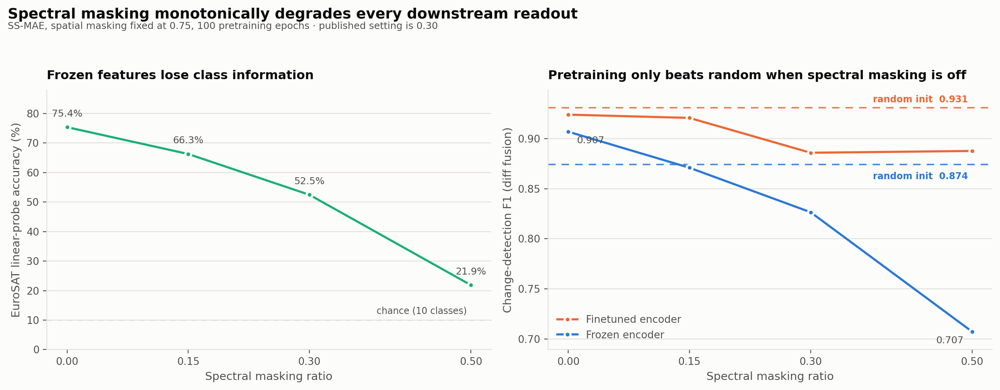

**Mechanism:** the pretraining loss curves.

| Spectral | Epoch 1 | Epoch 30 | Epoch 50 | Epoch 100 | Behaviour |
|---|---|---|---|---|---|
| 0.00 | 0.1313 | 0.0528 | 0.0342 | 0.0262 | smooth descent |
| 0.15 | 0.1304 | 0.1071 | 0.1070 | 0.0574 | stalled for ~40 epochs |
| 0.50 | 0.1310 | 0.1070 | 0.0763 | 0.0713 | never escapes |

A missing patch can be inpainted from its neighbours. A missing **band** has no spatial context to recover it
from, so the objective carries a large irreducible term, and most of the optimisation budget goes to a target
with no learnable signal. **Conclusion:** remove spectral masking. The effect is a 23-point drop in the probe
between 0.00 and 0.30, it is monotonic across all four settings, and the mechanism above explains it.

### B. Pretraining duration

*Question:* does more pretraining under the published recipe produce better features? This ablation covers ten
checkpoints plus a random-init control, in frozen and fine-tuned regimes: 22 runs, 20.8 minutes in total.

| Pretrain epochs | Frozen F1 | Frozen AUC | Fine-tuned F1 | Fine-tuned AUC |
|---|---|---|---|---|
| random init | **0.8054** | **0.8673** | **0.8923** | **0.9554** |
| 10 | 0.7054 | 0.6531 | 0.8668 | 0.9315 |
| 20 | 0.6667 | 0.5214 | 0.8500 | 0.9127 |
| 30 | 0.6689 | 0.5221 | 0.8486 | 0.9146 |
| 40 | 0.6757 | 0.5216 | 0.8486 | 0.9139 |
| 50 | 0.5763 | 0.5230 | 0.8634 | 0.9117 |
| 60 | 0.6657 | 0.6783 | 0.8075 | 0.8896 |
| 70 | 0.6985 | 0.7316 | 0.8830 | 0.9406 |
| 80 | 0.7023 | 0.7426 | 0.8896 | 0.9470 |
| 90 | 0.7153 | 0.7375 | 0.8744 | 0.9372 |
| 100 | 0.7198 | 0.7416 | 0.8829 | 0.9364 |

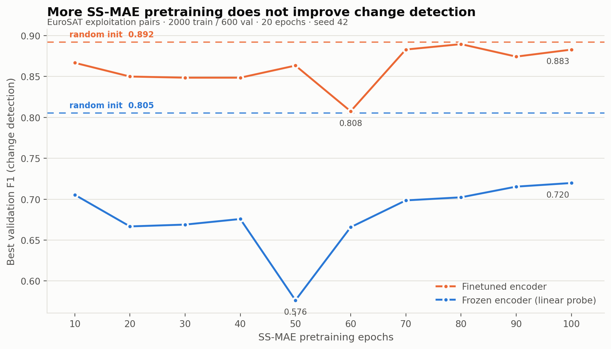

**No checkpoint beats random initialisation in either regime.** Between epochs 20 and 50, frozen AUC falls to
**0.52, which is chance**. The published recipe does not just fail to help: it *destroys* discriminative structure
that a random projection already preserves. A random high-dimensional projection roughly preserves pairwise
distances, which is exactly what a distance-based head needs.

### C. Fusion operator

*Question:* is the head's `|f1 − f2|` operator responsible for the result? This ablation crosses five operators
with pretrained/random initialisation and frozen/fine-tuned regimes: 20 runs, 19.1 minutes.

| Fusion | Order-aware | Frozen (pre) | Frozen (rand) | Fine-tuned (pre) | Fine-tuned (rand) |
|---|---|---|---|---|---|
| `\|f1 − f2\|` (original) | no | 0.7145 | 0.8027 | 0.8682 | 0.8863 |
| **`f1 − f2` (signed)** | **yes** | **0.8315** | **0.8744** | 0.8896 | **0.9309** |
| `[f1, f2]` | yes | 0.7881 | 0.8640 | 0.8988 | 0.9296 |
| `[\|f1 − f2\|, f1·f2]` | no | 0.6827 | 0.8109 | **0.9241** | 0.9124 |
| `[f1, f2, \|f1 − f2\|]` | yes | 0.7878 | 0.8576 | 0.9058 | 0.9283 |

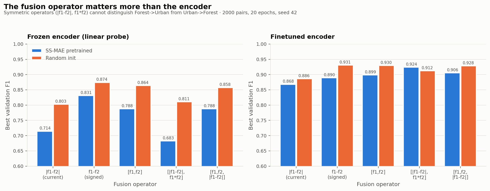

`|f1 − f2|` and `f1·f2` are exactly symmetric (verified numerically). They give the same output for Forest→Urban
and Urban→Forest, which removes the entire semantic content of an encroachment detector. Switching to the
signed difference gains up to **+0.117 F1**, more than any encoder change measured. Fusion alone does not rescue
pretraining, though: random init still wins in 9 of 10 cells. Ablation A identifies the actual cause.

---

## Synthesis: recommended configuration

| Component | As published | Recommended | Evidence |
|---|---|---|---|
| Spectral masking | 0.30 | **0.00 (off)** | Ablation A |
| Spatial masking | 0.75 | 0.75 (not yet ablated) | — |
| Fusion operator | `\|f1 − f2\|` | **`f1 − f2` (signed)** | Ablation C |
| Frozen CD F1 | 0.8266 | **0.9070** (vs 0.8744 random) | Ablation A |
| EuroSAT linear probe | 52.46% | **75.37%** | Ablation A |

Together, the three ablations explain the original result:
- Under the published recipe, pretraining loses to random initialisation (Ablation B).
- The cause is spectral masking, which makes the pretext task partly unlearnable (Ablation A).
- Separately, the symmetric fusion operator discards the direction of change and costs about 0.1 F1 (Ablation C).

Fixing both gives the first configuration in which pretraining beats random initialisation.

---

## What the evidence supports (paper direction)

**No longer supportable:** "dual spatial-spectral masking improves encroachment detection". The 0.95 headline also
goes, because it came from an uncontrolled comparison.

**Supported claims:**

- **C1. Spectral masking is counterproductive for MAE pretraining on multispectral imagery.** A removed band
  cannot be recovered from spatial context, so the objective has a large irreducible term. The evidence is
  dose-response across 4 settings, the loss curves, and a 23-point probe gap.
- **C2. Head design dominates encoder pretraining on this task.** A symmetric fusion operator costs more F1 than
  the entire pretraining stage adds, and it is ill-posed for directional change.
- **C3. Pretraining gains are conditional, and ablation can identify the conditions.** Ablation B is the
  negative case and Ablation A is its resolution.

---

## Threats to validity

- **Single seed (42).** Large effects (the 23-point probe collapse, the +0.117 fusion gain) are far outside
  plausible noise. Differences of about 0.02 are not interpretable. C1 and C2 need 3–5 seeds.
- **Proxy change task.** The training pairs are two *unrelated* EuroSAT scenes of different classes, which is
  closer to "different class?" than to real temporal change. This inflates absolute F1 and may interact with the
  fusion result.
- **Model selection on the validation set.** Best-epoch F1 is taken on the same split that is reported. This is
  optimistic in absolute terms, but it is applied identically to every arm.
- **One dataset at one scale.** All pretraining uses EuroSAT at 64×64. Larger tiles and other sensors are
  untested.
- **LEVIR variant.** The data is the original LEVIR-CD, not LEVIR-CD+.

---

## Next experiments

In priority order:

| # | Experiment | Supports | Est. cost |
|---|---|---|---|
| 1 | Repeat Ablations A and C at 3–5 seeds | C1, C2 (required) | ~4 h |
| 2 | Re-run label efficiency with the corrected recipe | C3, likely the new headline | ~1 h |
| 3 | Spatial masking ratio sweep (0.25–0.90) | completes the masking story | ~2.5 h |
| 4 | Band-subset ablation vs the learned ranking | validates the spectral-uniqueness reading | ~1 h |
| 5 | Co-located bitemporal pairs from OSCD / LEVIR-CD | addresses the proxy-task threat | ~2 h |
| 6 | Layer-wise freezing (k of 8 blocks) | locates transferable features | ~1 h |

---

## Reproducing

```bash
pip install torch torchvision einops scikit-learn rasterio pandas matplotlib tqdm pillow reportlab
```

1. Download the three datasets from Kaggle (see [Data](#data)) and extract them into the repo root as
   `eurosat-dataset/`, `levir-cd-change-detection/` and `oscd-dataset/`. The notebook also finds them under
   `/kaggle/input/...` when run on Kaggle.
2. *(Optional, skips several hours of training.)* Download `ssmae_checkpoints_minimal.zip` (~1 GB) from the
   [Releases page](https://github.com/karkisav/SSMAE/releases) and unzip it in the repo root:

   ```bash
   unzip ssmae_checkpoints_minimal.zip     # creates ./checkpoints/...
   ```

   It contains every checkpoint the notebook needs to run end to end without training: the pretrained encoder,
   both classifiers, the adaptive-masking model, all six change detectors and baselines, and the cached sweep
   results. `CHECKPOINTS.txt` inside the zip lists each file.
3. Run `notebooks/ssmae_pipeline.ipynb` from top to bottom. It switches its working directory to the repo root,
   writes weights to `checkpoints/`, figures to `figures/` and tables to `results/`. With the default
   `FORCE_RETRAIN = False`, each stage loads its checkpoint if one is present and trains it otherwise. Set it to
   `True` to retrain everything.
4. Ablations. Ablation B uses the intermediate pretraining checkpoints (epochs 10–90), and Ablation A uses its own
   pretrained arms in `ablations/ckpt/`. Neither set is in the minimal zip. Without them, Ablation B evaluates
   only the checkpoints that exist, and Ablation A retrains its missing arms (~2 h).

   ```bash
   python ablations/ablation_spectral.py         # A  (~2 h)
   python ablations/ablation_pretrain_epochs.py  # B  (~20 min)
   python ablations/ablation_fusion.py           # C  (~20 min)
   python ablations/plot_spectral.py && python ablations/plot_pretrain_epochs.py && python ablations/plot_fusion.py
   python ablations/build_report.py              # → reports/SSMAE_ablation_report.pdf
   ```

Hardware used: one NVIDIA RTX 4500 Ada. Pretraining takes about 20 s per epoch, so 100 epochs is about 35 minutes.
